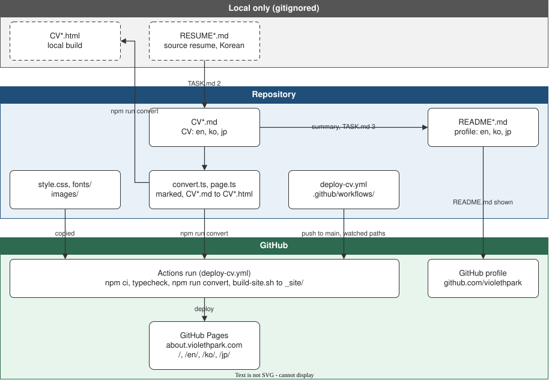

# ARCHITECTURE.md — 저장소 구조

GitHub 프로필 페이지와 CV 사이트(about.violethpark.com)가 어떤 파일에서 어떻게 만들어지는지 정리한다.
작업 순서는 [TASK.md](TASK.md), 작업 규칙은 [AGENTS.md](AGENTS.md)를 따른다.

[draw.io](diagrams/repo-structure.drawio) · [Mermaid](diagrams/repo-structure.mmd)

## 파일 역할

| 파일 | 역할 | 결과물 / 노출 위치 |
| --- | --- | --- |
| `RESUME*.md` | 원본 이력서(한국어). gitignore 대상이라 로컬에만 있다 | `CV.md`의 사실 근거 |
| [CV.md](CV.md), [CV_ko.md](CV_ko.md), [CV_jp.md](CV_jp.md) | CV 원문(영어 기본, 한국어, 일본어) | `CV*.html`, CV 사이트 |
| [README.md](README.md), [README_ko.md](README_ko.md), [README_jp.md](README_jp.md) | CV 요약 프로필 | github.com/violethpark (`README.md`). 사이트에는 들어가지 않는다 |
| [convert.ts](convert.ts) | `CV*.md`를 marked로 `CV*.html`로 변환(`npm run convert`). 제목 id·자기 링크, 목차, 절 정보 패널과 버튼, 목차·닫기·테마 아이콘 버튼(인라인 SVG), 테마 버튼 옆 언어 전환(`EN · 한 · 日`, 30rem 이하에서는 목차 서랍 맨 위), 언어별 UI 글자를 만든다. `CV*.md` 맨 위 언어 줄은 GitHub용이라 HTML에는 그리지 않는다 | `CV*.html` |
| [heading-link.ts](heading-link.ts) | 본문 제목 h2~h4의 자기 링크. 제목 안 링크와 그 링크를 감싼 요소는 그대로 두고 밖의 구간만 감싼다. `convert.ts`가 쓰고 `npm test`(`heading-link.test.ts`)가 검사한다 | `CV*.html`의 제목 |
| [page.ts](page.ts) | 테마 버튼과 현재 절 표시. `convert.ts`가 각 페이지에 인라인한다 | `CV*.html` 안의 스크립트 |
| [style.css](style.css), [fonts/](fonts/fonts.json), [images/](images/) | CV HTML의 스타일(라이트·고대비 다크, 반응형 3단), 웹폰트 원본(IBM Plex Sans, Sarasa Mono Slab), 이미지 | 사이트에 복사된다. `style.css`·`fonts/`는 루트 한 벌. 본문 글꼴은 잘라서(`subset-fonts.py`) 둔다 |
| [build-site.ts](build-site.ts) | 변환된 `CV*.html`로 `_site/`를 만든다(복사, 언어 링크, CNAME, 글꼴 sha256 검사, 글꼴 서브셋). Node가 바로 실행한다(`npm run build-site`) | `_site/` |
| [subset-fonts.py](subset-fonts.py), [requirements-fonts.txt](requirements-fonts.txt) | IBM Plex Sans를 사이트에 쓰인 글자로 자르고, Reserved Font Name 때문에 `CV Sans`로 이름을 바꾼다. fontTools·brotli는 해시로 고정한다 | `_site/fonts/cv-sans/` |
| [deploy-cv.yml](.github/workflows/deploy-cv.yml) | main push(감시 경로) 또는 수동 실행 시 변환해 GitHub Pages에 배포 | about.violethpark.com `/`, `/en/`, `/ko/`, `/jp/` |
| [check.yml](.github/workflows/check.yml) | 모든 PR과 main push에서 TypeScript(tsc, `npm test`, ESLint, Prettier)와 `subset-fonts.py`(Pyright strict, Ruff)를 검사하고, 사이트를 `_site`처럼 만들어 본다(배포는 `deploy-cv.yml`). `ubuntu-26.04` runner 위의 고정한 Debian 컨테이너에서, uv로 받은 Python 3.14(workspace Dev Container와 같은 python-build-standalone)로 돈다 | PR 검사 결과 |
| [tsconfig.json](tsconfig.json), [config/lint/](config/lint/eslint.config.ts), [.prettierignore](.prettierignore), [pyrightconfig.json](pyrightconfig.json), [ruff.toml](ruff.toml), [typings/](typings/fontTools/), [requirements-dev.txt](requirements-dev.txt) | 검사 설정. 엄격 옵션과 규칙은 violethpark/workspace `.devcontainer`를 따른다. ESLint는 TypeScript 6이 필요해 `config/lint/` 패키지에 따로 두고, fontTools는 쓰는 API만 stub(`typings/`)으로 둔다 | `npm run typecheck`, `test`, `lint`, `format:check`, `pyright`, `ruff` |
| `CV*.html`, `_site/` | 변환 결과와 사이트. gitignore 대상이라 커밋하지 않는다 | 로컬 확인용 |
| [diagrams/](diagrams/) | 이 문서의 그림 | — |

감시 경로와 배포 단계는 [deploy-cv.yml](.github/workflows/deploy-cv.yml)이 정본이다.
`ARCHITECTURE.md`와 `diagrams/`는 감시 경로에 없어서 고쳐도 배포가 실행되지 않는다.

## 그림 갱신

- `.mmd`는 구조, `.drawio`는 모양의 정본이고, `.drawio.svg`는 `.drawio`에서 내보낸 결과다.
- 발행 흐름이 바뀌면 같은 PR에서 `.mmd`, `.drawio`, `.drawio.svg`와 이 문서의 표를 함께 고친다.
